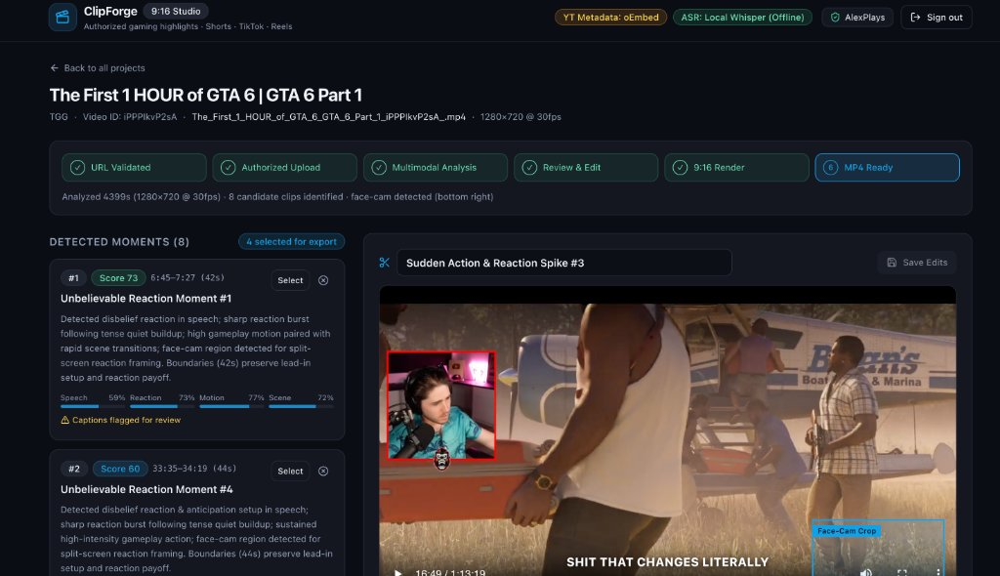

<div align="center">

# ClipForge

### Autonomous AI Video Clipping, Live Stream Slicing & AI Director Studio

[](https://clipforge-app-production.up.railway.app)
[](https://nextjs.org/)
[](https://www.postgresql.org/)
[](https://www.prisma.io/)
[](https://ffmpeg.org/)
[](https://groq.com/)

**Live Production App:** [https://clipforge-app-production.up.railway.app](https://clipforge-app-production.up.railway.app)

</div>

---

**ClipForge** is a local-first, **AI-powered video clipping studio** that ingests long-form VODs, podcasts, recordings, and live streams, detects high-impact moments across speech, audio, motion, and chat signals, lets you **chat directly with your own Claude, ChatGPT, OpenRouter, Gemini, Groq, or local Ollama models** to find moments and apply edits, and exports platform-ready **9:16 vertical MP4 clips** for **YouTube Shorts**, **TikTok**, and **Instagram Reels**.



---

## Key Features

- **AI Video Director Chat (BYOK — Bring Your Own Key)** — Connect your own **Anthropic Claude**, **OpenAI ChatGPT**, **OpenRouter**, **Google Gemini**, **Groq**, or **Local / Custom OpenAI-compatible** (Ollama, LM Studio, vLLM) API keys at `/settings/ai`. Keys are encrypted at rest with **AES-256-GCM** per user on your local system. Inside any project workspace, chat with your connected model using server-validated tool calls to:
  - `search_transcript`: search multi-hour VOD/podcast transcripts by keyword or time window
  - `get_timeline_events`: inspect audio reactions, silence-to-burst peaks, motion bursts, scene cuts, and chat velocity spikes
  - `create_clip_candidate`: create new clips at exact timestamps with synced transcript captions
  - `update_clip_candidate`: trim boundaries, rename, select/discard, switch 9:16 layouts, style captions, or convert captions to Banglish
  - `queue_clip_render`: queue 9:16 MP4 exports on demand
- **Direct Media Ingestion & Real-Time Live Stream Slicing** — Paste a YouTube, Twitch, podcast, or `.m3u8` HLS link (or upload local MP4/MOV/WebM/MKV files). For live streams, ClipForge resolves dual HLS manifests (`sgovp` video + `sgoap` audio), monitors audio & live chat velocity spikes (MPS & hype keywords), and selectively slices highlight buffers without audio drift.
- **Synchronized Multimodal Moment Detection** — Scores candidates across speech cues, relative baseline-contrast audio reactions (never loudness-only), FFmpeg gameplay motion & scene cuts, chat velocity, and corner face-cam detection while preserving setup and post-peak punchline boundaries.
- **Bangla & Romanized Banglish Captions + 100% Free STT Options** — Supports **Local Offline `whisper.cpp`**, **Groq Free Tier (`whisper-large-v3-turbo`)**, self-hosted Whisper APIs, OpenAI Whisper, or zero-key manual fallback. Includes native **`Bangla (bn)`** and **`Banglish (bn_en)`** support with deterministic Bengali-to-Banglish transliteration (plus a one-click **To Banglish** converter in the Studio Captions tab) so burned-in `.ass` captions render cleanly on Latin fonts without broken Unicode conjuncts.
- **Interactive 9:16 Review & Editing Studio** — Obsidian Slate & Broadcast Amber studio interface featuring HTTP `Range`-streaming playback, interactive timeline event ticks, start/end boundary trimmers, editable word-timed captions with low-confidence review flags, and 3 vertical composition modes (`Split Cam Top`, `Face-Cam PiP`, `Gameplay Focus`).
- **Storage Safeguard & External Drive Routing** — Automatically detects available volumes (including external drives under `/Volumes` on macOS) and warns when free disk space is low, letting you switch `LOCAL_STORAGE_DIR` and `TEMP_WORK_DIR` directly from the dashboard.
- **Platform-Friendly 1080×1920 MP4 Exports** — Isolated FFmpeg background rendering with safe-zone margins for **YouTube Shorts**, **TikTok**, and **Instagram Reels** (local MP4 download only; never auto-publishes).

---

## Architecture

```text
ClipForge/
├── packages/
│   ├── core/          # Domain types, Zod schemas, typed job & render state machine,
│   │                  # AES-256-GCM BYOK key encryption & provider catalog,
│   │                  # Bengali-to-Banglish transliterator, YouTube URL/metadata helpers,
│   │                  # scrypt/session auth, local/S3 object storage, scoring & ASS captions
│   └── db/            # Prisma schema (ClipJob, CandidateClip, TranscriptSegment, SceneEvent,
│                      # RenderExport, LiveSession, AiProviderConfig, JobChatMessage) & migrations
├── apps/
│   ├── web/           # Next.js 15 App Router, React 19, TypeScript, Tailwind CSS,
│   │                  # AI Provider settings (/settings/ai), AI Video Director agent & chat API,
│   │                  # streaming uploads, Range playback, storage & export APIs
│   └── worker/        # Standalone background worker: yt-dlp media scraper, live HLS/chat monitor,
│                      # FFprobe, PCM audio analysis, Groq / whisper.cpp / OpenAI / VTT STT,
│                      # scene/motion & face-cam detection, isolated FFmpeg 9:16 renderer
├── docs/              # Documentation assets & screenshots
├── docker-compose.yml # Optional PostgreSQL 16 service
└── .env.example       # Documented environment variables (placeholders only)
```

### Job Lifecycle & Live Ingestion Pipeline

```text
(VOD / Scrape / Upload)
queued ──▶ uploading ──▶ analyzing ───────┐
  │            │             │            ▼
  │            │             │   candidates_ready ──▶ rendering ──▶ complete
  │            │             │            ▲                 │
  ▼            ▼             ▼            │                 ▼
(Ongoing Live Stream)                     │               failed
live_monitoring ──────────────────────────┘
```

- All job progress, transcript segments, scene events, candidate clips, AI chat history, and render exports persist in PostgreSQL — you can refresh or resume anytime.
- Failed jobs and individual renders have deterministic, idempotent retry paths via `@clipforge/core` state-machine checks.

---

## Tech Stack

| Layer | Technology |
| --- | --- |
| Web App | Next.js 15 (App Router), React 19, TypeScript, Tailwind CSS, Lucide Icons |
| Validation & Core | Zod, strict TypeScript (`@clipforge/core` + browser-safe `@clipforge/core/client`) |
| AI Director (BYOK) | Native Anthropic Messages API + OpenAI-compatible Chat Completions (OpenAI, OpenRouter, Gemini, Groq, Ollama/LM Studio) with server-side tool execution |
| Persistence | PostgreSQL 15+, Prisma ORM (SQL migrations & schema included) |
| Media & Rendering | Isolated Node worker, `yt-dlp`, FFmpeg / FFprobe, ASS burned captions |
| Speech-to-Text | Local `whisper.cpp` (free & offline), Groq Whisper (free tier), custom Whisper API, OpenAI Whisper, native `.vtt` subtitle ingestion, plus Bangla/Banglish support |
| Object Storage | Local disk storage (with external volume switcher) or S3-compatible storage (AWS S3, Cloudflare R2, MinIO) |
| Testing | Vitest unit tests across `@clipforge/core`, `@clipforge/worker`, and `@clipforge/web` |

---

## Quick Start

### Prerequisites

- **Node.js 20+** and **pnpm 10+**
- **PostgreSQL 15+** (local Postgres or Docker via `docker compose up -d`)
- **FFmpeg / FFprobe** (auto-resolved from `FFMPEG_PATH`, system `PATH`, or bundled `ffmpeg-static` / `ffprobe-static`)
- **`yt-dlp`** (optional, for direct URL media scraping and live manifest resolution)

### 1. Clone & Install

```bash
git clone https://github.com/MahdiHassanGo/ClipForge.git
cd ClipForge
pnpm install
```

### 2. Configure Environment Variables

Copy `.env.example` to `.env` and fill in your local database URL and session secret:

```bash
cp .env.example .env
```

Generate a random `SESSION_SECRET`:

```bash
openssl rand -hex 32
```

### 3. Choose a Free Speech-to-Text Option (Optional)

With `STT_PROVIDER="auto"` (default):

- **Option A — Groq Free Whisper (`whisper-large-v3-turbo`, No Credit Card)**
  Get a free API key at <https://console.groq.com/keys> and set in `.env`:
  ```env
  GROQ_API_KEY="gsk_your_free_key_here"
  ```

- **Option B — Local Offline Whisper (`whisper.cpp`, 100% Free & Unlimited on Apple Silicon)**
  ```bash
  brew install whisper-cpp
  pnpm download:models
  ```
  Configure in `.env`:
  ```env
  LOCAL_WHISPER_BIN="whisper-cli"
  LOCAL_WHISPER_MODEL="auto"
  WHISPER_THREADS="6"
  ```

- **Option C — Zero Setup (Manual Caption Mode)**
  Leave both blank. Audio dynamics, motion, scene cuts, face-cam detection, and 9:16 rendering still run normally, and speech-activity intervals are flagged for manual caption editing.

### 4. Push / Migrate Database Schema

If using Docker for PostgreSQL:

```bash
docker compose up -d
```

Generate Prisma Client and sync the schema:

```bash
pnpm db:generate
pnpm db:push
```

### 5. Run Web App & Background Worker

Start both together:

```bash
pnpm dev
```

Or in separate terminals:

```bash
pnpm dev:web     # Next.js web app & API on http://localhost:3000
pnpm dev:worker  # Background scraper, STT, analysis & FFmpeg 9:16 render worker
```

Open **http://localhost:3000**, create an account, connect your preferred AI key under **AI Keys** (`/settings/ai`), paste a video or stream URL, and use the **AI Director Chat** inside the studio to find moments and edit clips.

---

## Environment Variables

| Variable | Required | Description |
| --- | --- | --- |
| `DATABASE_URL` | Yes | PostgreSQL connection string |
| `SESSION_SECRET` | Yes | Random 32+ byte secret for session hashing and local AI key encryption fallback |
| `AI_KEY_ENCRYPTION_SECRET` | Optional | Dedicated secret for AES-256-GCM encryption of user-connected AI API keys (falls back to `SESSION_SECRET`) |
| `YOUTUBE_API_KEY` | Optional (Free) | YouTube Data API v3 key for live/archived stream detection & duration (falls back to official oEmbed) |
| `STT_PROVIDER` | No | `auto` (default), `groq`, `local_whisper`, `custom`, `openai`, or `none` |
| `GROQ_API_KEY` | Optional (Free) | Free Groq API key for fast `whisper-large-v3-turbo` word-level transcription |
| `LOCAL_WHISPER_MODEL_PATH` | Optional (Free) | Path to local `whisper.cpp` ggml model (e.g. `./models/ggml-large-v3-turbo.bin`) |
| `LOCAL_WHISPER_BIN` | No | Path/name of `whisper-cli` binary (default `whisper-cli`) |
| `STT_BASE_URL` / `STT_API_KEY` | Optional | Custom self-hosted OpenAI-compatible Whisper endpoint |
| `OPENAI_API_KEY` | Optional (Paid) | Optional OpenAI Whisper key |
| `STORAGE_PROVIDER` | No | `local` (default) or `s3` |
| `LOCAL_STORAGE_DIR` | No | Local object storage directory (default `./storage`, configurable from UI) |
| `TEMP_WORK_DIR` | No | Temporary worker directory (default `./tmp/clipforge-worker`, configurable from UI) |
| `S3_BUCKET`, `S3_REGION`, `S3_ENDPOINT`, `S3_ACCESS_KEY_ID`, `S3_SECRET_ACCESS_KEY` | Only if `STORAGE_PROVIDER=s3` | S3-compatible object storage credentials |
| `MAX_UPLOAD_BYTES` | No | Max upload size in bytes (default `1073741824` = 1 GiB) |
| `CLIP_DEFAULT_MIN_SECONDS`, `CLIP_DEFAULT_MAX_SECONDS`, `CLIP_DEFAULT_TARGET_SECONDS`, `CLIP_SCORE_THRESHOLD`, `CLIP_MAX_CANDIDATES` | No | Configurable clip selection defaults (20–60s, target 35s) |

---

## Scripts

```bash
pnpm dev               # Run web app + background worker in parallel
pnpm build             # Build core, db, worker, and Next.js production bundle
pnpm typecheck         # Strict TypeScript check across all workspace packages
pnpm lint              # Lint/type-check workspace packages
pnpm test              # Run Vitest unit test suites (core, worker, web)
pnpm db:push           # Push Prisma schema to PostgreSQL
pnpm db:migrate:deploy # Apply Prisma PostgreSQL migrations
```
